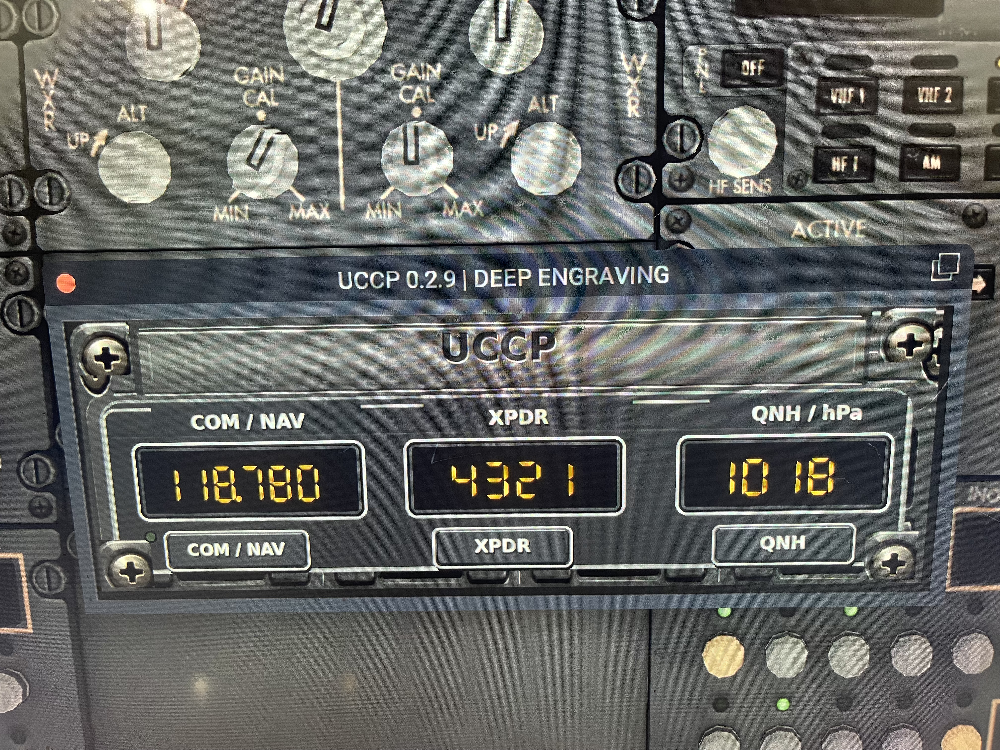
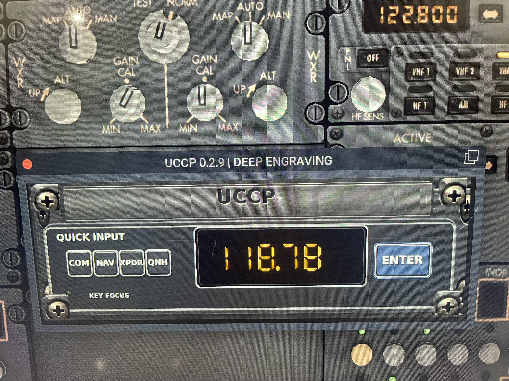
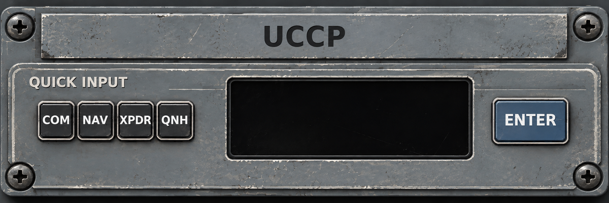
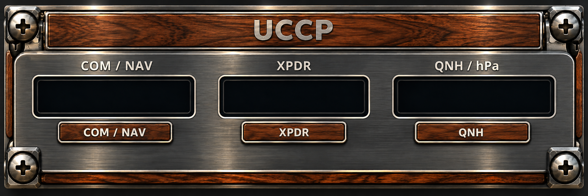

# ✈️ UCCP
### Universal Cockpit Control Panel

**Less time adjusting. More time flying.**

*Keyboard-first COM, NAV, transponder and QNH control for X-Plane.*

   

---

> [!IMPORTANT]
> **X-Plane 11 tested · X-Plane 12 not yet verified.** We warmly welcome XP12 volunteers. Please share successful tests and issues through this repository's **Issues** tab.

## The idea

Busy cockpit? New ATC frequency? Transponder change during departure?

**UCCP keeps essential inputs within reach of the keyboard**, reducing mouse work when your attention belongs on the flight. Built with online flying in mind, including VATSIM.

## At a glance

| Control | What it does |
|:--|:--|
| **COM1** | Enter standby frequencies and swap; optional deliberate direct-active entry |
| **NAV1** | Enter navigation frequencies |
| **XPDR** | Set a four-digit transponder code |
| **QNH** | Adjust barometric pressure |
| **Quick Input** | Compact entry view with immediate visual feedback |
| **Skins** | Multiple cockpit styles, including **WOOD** and **WOOD2** |

### Faster frequency entry

| Type | UCCP interprets |
|:--:|:--:|
| `1187` | `118.700 MHz` |
| `12105` | `121.050 MHz` |

No decimal point required.

## Keyboard reference

| Shortcut | Action |
|:--|:--|
| **Ctrl + Alt + U** | Open / focus UCCP |
| **C** | COM/NAV selection |
| **N** | Toggle NAV display |
| **T** | Transponder input |
| **Q** | QNH input |
| **S** | Swap radio active / standby |
| **Enter** | Confirm entry (normally standby for COM) |
| **Ctrl + Enter** | Deliberately set COM active frequency |
| **Esc** | Cancel / close and return focus to X-Plane |

The default **SESSION** mode allows several inputs without reopening the panel. An optional **SINGLE** mode closes after confirmation.

## Designed for the cockpit

- **Pilot-controlled frequency changes:** UCCP does not automatically switch the active COM frequency.
- **Input validation:** Invalid entries are rejected and signaled visually.
- **Compact, movable interface:** Position the window to fit your cockpit view.
- **Offline functionality:** Core controls do not require an online service.
- **Appearance options:** Boeing-inspired and alternative finishes, including wood skins.

## Compatibility and testing

| Platform | Status |
|:--|:--|
| **X-Plane 11** | ✅ Developed and tested |
| **X-Plane 12** | 🧪 **Not yet tested — volunteers welcome** |

UCCP is a **FlyWithLua** script. Its behavior may depend on simulator version, FlyWithLua version and aircraft datarefs.

### ✈️ X-Plane 12 pilots: we'd love your help!

If you have X-Plane 12, please test when a downloadable release is available and open an **Issue** with your findings. In particular, we're interested in:

1. Installation and startup, including FlyWithLua errors
2. **Ctrl + Alt + U** focus and **Esc** behavior
3. COM1 and NAV1 frequency entry / swap
4. XPDR and QNH operation
5. Window position, size and skin rendering
6. Aircraft compatibility and any reproducible problems

**Successful XP12 tests are just as valuable as bug reports.** Thank you!

## Installation

> [!NOTE]
> **Installation package and step-by-step instructions will be added with the first release.** This README introduces the project; a repository containing only this README is not yet an installable download.

When the release is available, check its instructions and included configuration files before installing. Please keep a backup of your existing FlyWithLua scripts and settings.

## Screenshots and brochure

Explore UCCP in action — from the Boeing 737 cockpit to our custom-designed panel skins.

### ✈️ UCCP in the Boeing 737 cockpit

### 🎛️ Quick Input — Boeing 737

### 🛫 Boeing 737 Panel

### 🪵 WOOD Skin

---

### 📖 Illustrated UCCP Brochure

Discover the project, its design philosophy and its features in our illustrated English-language brochure.

**[📄 Open the illustrated UCCP brochure (PDF)](docs/UCCP_Introduction_EN_Final_Dark_Logo%202.pdf)**

---

## Development and acknowledgements

**Project concept, product direction, cockpit testing and publication:** Gerd Steeger  
**AI co-development, code assistance, interface iteration and documentation:** ChatGPT by OpenAI

UCCP grew through repeated real-world simulator tests and collaborative refinement. The project also acknowledges **VR Radio Helper** as an inspiration for streamlined cockpit radio controls. Any reused third-party code or assets must retain the applicable attribution and license terms.

## Community

Have a suggestion, compatibility report or bug? Please use **Issues** in this repository. This is a noncommercial hobby project intended to help fellow flight-simulation pilots.

> [!CAUTION]
> UCCP is intended **only for flight simulation**, not for use in real aircraft.

---

### Keep your eyes on the flight.
**Less time adjusting. More time flying.** ✈️

